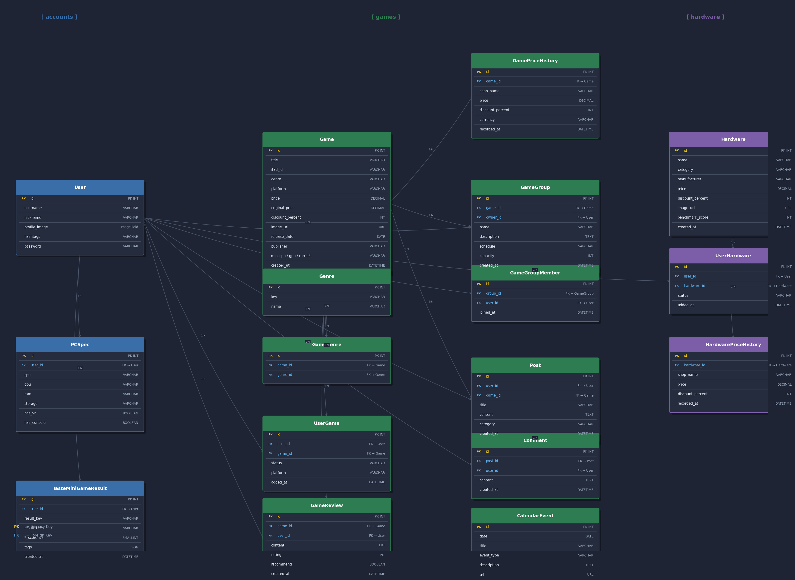

# GameFit — AI 기반 게임 추천 플랫폼

> 내 PC 사양, 게임 취향, 예산에 맞는 게임을 AI가 추천해주는 게이밍 올인원 플랫폼

---

## A. 팀원 정보 및 업무 분담 내역

| 이름 | 역할 | 담당 업무 |
|------|------|-----------|
| 윤광혁 (팀장) | Backend | DB 설계, 데이터 수집, Open API 연동, 백엔드 구현 |
| 정지수 (팀원) | Frontend | 성향 분석 & 미니게임 기능 구현, UI/UX 디자인, 프론트엔드 구현 |

### Git 협업 원칙

**브랜치 전략**
- `main` — 최종 배포 브랜치
- `feature/<기능명>` — 기능별 개발 브랜치 (예: `feature/ai-search`, `feature/community`)
- 기능 완료 후 `main`으로 PR → 상호 코드 리뷰 후 병합

**커밋 메시지 컨벤션**
```
feat: 새로운 기능 추가
fix: 버그 수정
refactor: 코드 리팩토링
docs: 문서 수정
style: 코드 포맷팅
chore: 패키지/설정 변경
```

---

## B. 목표 서비스 및 실제 구현 정도

### 목표 서비스
게임 가격 추적, PC 호환성 분석, 취향 기반 AI 추천, 커뮤니티를 통합한 게이밍 플랫폼

### 실제 구현 현황

| 기능 분류 | 기능 | 구현 여부 |
|-----------|------|-----------|
| 인증 | 회원가입 / 로그인 / JWT 인증 | ✅ |
| 인증 | 팔로우 / 팔로워 소셜 기능 | ✅ |
| 인증 | 프로필 편집 / PC 스펙 등록 | ✅ |
| 게임 | 게임 목록 조회 (필터·정렬·검색) | ✅ |
| 게임 | 게임 상세 (가격·리뷰·커뮤니티) | ✅ |
| 게임 | 소유/관심 게임 보관함 | ✅ |
| 게임 | 별점·추천 리뷰 시스템 | ✅ |
| 가격 | ITAD 실시간 다중 쇼핑몰 가격 | ✅ |
| 가격 | 가격 히스토리 그래프 (67,396건) | ✅ |
| 가격 | USD/EUR/GBP/JPY → KRW 환율 변환 | ✅ |
| AI | 자연어 게임 검색 (GPT) | ✅ |
| AI | 구매 타이밍 분석 (점수 기반 + GPT) | ✅ |
| AI | PC 호환성 분석 (GPT) | ✅ |
| AI | 장비 업그레이드 비교 (GPT) | ✅ |
| 추천 | 취향 미니게임 "도트 원정대" | ✅ |
| 추천 | 취향 벡터 기반 게임 추천 | ✅ |
| 하드웨어 | 하드웨어 탐색 / 벤치마크 비교 | ✅ |
| 하드웨어 | 가격 히스토리 (1,046건) | ✅ |
| 커뮤니티 | 게임별 게시판 (카테고리 분류) | ✅ |
| 커뮤니티 | 좋아요 / 댓글 | ✅ |
| 커뮤니티 | 게이밍 그룹 모집 / 참가 | ✅ |
| 캘린더 | 할인·출시 이벤트 캘린더 | ✅ |
| 배포 | 서비스 배포 | 🔲 |

---

## C. 데이터베이스 모델링 (ERD)



### 주요 모델 관계 요약

```
User ──────────────────────────────────────────────────────
  │  ├─[M:M]─► Game          (UserGame: owned / interested)
  │  ├─[M:M]─► Hardware      (UserHardware: owned / interested)
  │  ├─[M:M]─► User          (followers 자기참조)
  │  ├─[1:N]─► GameReview
  │  ├─[1:N]─► Post
  │  ├─[1:N]─► Comment
  │  ├─[1:1]─► PCSpec        (CPU / GPU / RAM / Storage / VR / Console)
  │  └─[1:N]─► TasteMiniGameResult

Game ──────────────────────────────────────────────────────
  │  ├─[1:N]─► GameReview
  │  ├─[1:N]─► Post ──[1:N]──► Comment
  │  ├─[1:N]─► GameGroup ──[M:M]──► User (GameGroupMember)
  │  ├─[M:M]─► Genre        (GameGenre 중간 테이블)
  │  └─[1:N]─► GamePriceHistory

Hardware ──────────────────────────────────────────────────
       └─[1:N]─► HardwarePriceHistory
```

---

## D. 추천 알고리즘에 대한 기술적 설명

### 1. 취향 벡터 생성 — 가중 합산 방식

사용자의 게임 취향을 8가지 축(axis)으로 정량화합니다.

```
최종 취향 벡터 = 미니게임 결과  × 0.60
              + 소유 게임 장르 분포 × 0.25
              + 관심 게임 장르 분포 × 0.15
```

**8가지 취향 축**

| 축 | 대표 장르 |
|----|-----------|
| 경쟁심 (Competitive) | FPS, 스포츠 |
| 공략가 (Strategy) | 전략, 시뮬레이션 |
| 탐험가 (Exploration) | 어드벤처, RPG |
| 파티형 (Social) | RPG, 전략, 어드벤처 |
| 서사형 (Story) | RPG, 어드벤처, 인디 |
| 액션형 (Action) | FPS, 스포츠 |
| 하드코어 (Challenge) | 호러, FPS |
| 힐링형 (Cozy) | 인디, 시뮬레이션, 어드벤처 |

**장르 → 취향 축 매핑**
```python
FPS        → 액션형, 경쟁심, 하드코어
RPG        → 탐험가, 파티형, 서사형
인디       → 힐링형, 서사형
전략       → 공략가, 파티형
시뮬레이션 → 공략가, 힐링형
어드벤처   → 탐험가, 서사형, 힐링형
스포츠     → 경쟁심, 액션형
호러       → 하드코어
```

### 2. 추천 게임 선정 로직

```
① 최종 취향 벡터에서 상위 2~3개 축 추출
② 해당 축에 매핑된 장르 게임 필터링
③ 이미 소유 / 관심 등록된 게임 제외
④ 할인율 → 가격 → 출시일 순 정렬
⑤ 최대 3개 반환
   (데이터 부족 시 → 전체 할인율 Top 게임 fallback)
```

### 3. 구매 타이밍 분석 알고리즘

ITAD API에서 수집한 가격 데이터를 기반으로 0~100점 구매 타이밍 점수를 산출합니다.

| 항목 | 가중치 | 산출 방식 |
|------|--------|-----------|
| 현재가 vs 역대 최저가 | 35% | 최저가 대비 현재가 비율 |
| 현재 할인율 | 25% | 정가 대비 할인 % |
| 1년 가격 히스토리 | 20% | 1년 평균 대비 현재가 위치 |
| 3개월 가격 히스토리 | 10% | 3개월 평균 대비 현재가 위치 |
| 출시 후 경과 일수 | 10% | 출시 초기 고가 구간 보정 |

**등급 기준**
```
≥ 50점 → buy_now  "지금 구매 추천"
≥ 25점 → good     "관심 등록 추천"
≥ 10점 → watch    "가격 추적 추천"
<  10점 → wait     "대기 추천"
```

점수 산출 후 GMS(GPT)가 한국어 헤드라인 + 설명 문장을 생성하며, API 오류 시 미리 정의된 템플릿 문구로 fallback합니다.

---

## E. 핵심 기능에 대한 설명

### 1. 실시간 게임 가격 추적
- **IsThereAnyDeal(ITAD) API** 연동으로 Steam, Epic Games, Ubisoft 등 다중 쇼핑몰 실시간 가격 조회
- **Frankfurter API**로 USD/EUR/GBP/JPY → KRW 자동 환율 변환 (쇼핑몰별 통화 자동 감지)
- 가격 히스토리 데이터 **67,396건** 보유, 그래프 시각화
- 역대 최저가 / 1년 최저가 / 3개월 최저가 구분 표시
- 30분 인메모리 캐싱으로 API 호출 최소화

### 2. 취향 미니게임 "도트 원정대"
- 8가지 취향 축에 대한 문답형 퀴즈
- 결과로 유저 취향 프로필 생성 → 즉시 게임 추천 연동
- 이전 결과 히스토리 저장, 취향 변화 추이 확인 가능

### 3. PC 호환성 분석
- 내 PC 스펙(CPU/GPU/RAM)을 프로필에 등록
- 게임 상세 페이지에서 최소/권장 사양과 자동 비교
- 컴포넌트별 상태: `pass` / `warn` / `fail` / `unknown`
- GPT가 종합 호환 평가 문장 생성

### 4. AI 자연어 검색
- 게임: "긴장감 있는 멀티 FPS 추천해줘" 형식 쿼리 지원
- 장비: "4K 게이밍 모니터 추천해줘" 형식 쿼리 지원
- GPT가 카탈로그 전체를 분석해 관련 항목 반환
- 로컬 키워드 매칭 fallback으로 API 오류 대응

### 5. 게이밍 그룹 모집
- 게임별 그룹 생성 / 참가 / 탈퇴
- 일정, 플레이 스타일, 필요 역할 설정
- 정원 초과 자동 차단 (2~20명), 방장 자동 위임

### 6. 하드웨어 탐색 & 장비 분석
- 15개 카테고리 (CPU, GPU, RAM, 모니터, 마우스, VR 등) 하드웨어 **1,000개** 보유
- 벤치마크 점수 기반 성능 비교
- **장비 게임 적합도**: 해당 장비로 내 라이브러리 게임 중 어떤 게임에 가장 적합한지 AI 분석
- **PC 업그레이드 비교**: 현재 부품 vs 업그레이드 후보 성능 향상 비율 AI 분석

---

## F. 생성형 AI 활용

사용 모델: **GMS API (SSAFY 제공)** — `gpt-5-nano`  
OpenAI SDK 활용, 모든 AI 기능에 로컬 fallback 구현

| 기능 | 활용 방식 |
|------|-----------|
| AI 게임 자연어 검색 | 사용자 쿼리 + 게임 카탈로그 → GPT가 관련 game_ids 반환 |
| AI 장비 자연어 검색 | 사용자 쿼리 + 벤치마크 데이터 → GPT가 관련 hw_ids 반환 |
| 구매 타이밍 메시지 | 점수 계산 후 GPT가 한국어 추천 문구 생성 |
| PC 호환성 분석 | 스펙 데이터 전달 → GPT가 부품별 평가 + 종합 의견 생성 |
| 장비 게임 적합도 | 게임 요구사양 + 장비 스펙 → GPT가 적합도 분석 |
| 장비 업그레이드 비교 | 현재/후보 스펙 비교 → GPT가 업그레이드 가치 판단 |

**공통 설계 원칙**
- GPT 응답 실패 / 타임아웃 시 모든 엔드포인트에 fallback 로직 적용
- System Prompt로 역할 명확히 지정 (검색 AI, 분석 AI 등 구분)
- 카탈로그 전달 시 compact 포맷(id, title, tags, 할인율)으로 토큰 최소화

---

## G. 서비스 URL

> 배포 예정

---

## H. 기타

### 데이터 확보 현황

| 데이터 | 건수 | 출처 |
|--------|------|------|
| 게임 데이터 | 208개 | ITAD API |
| 게임 가격 히스토리 | 67,396건 | ITAD API |
| 하드웨어 데이터 | 1,000개 | Naver Shopping API |
| 하드웨어 가격 히스토리 | 1,046건 | Naver Shopping API |

### API Key 관리
- `python-dotenv` 로 `.env` 파일 관리
- `.env.example` 파일로 변수 형식 공유
- `.gitignore`에 `.env` 등록 → 실제 키 값 미노출

### 개발하면서 어려웠던 점

**1. Git Merge 충돌**  
백엔드와 프론트엔드를 병렬 개발하다 보니 `main` 브랜치 병합 시 같은 파일(특히 `urls.py`, `router/index.js`)에서 충돌이 자주 발생했습니다. 충돌 원인을 파악하고 `git diff`로 변경 내역을 비교하며 수동으로 해결하는 과정에서 Git 협업 방식에 대한 이해가 깊어졌습니다.

**2. git reset / revert 활용**  
기능 개발 중 잘못된 커밋이 `main`에 병합되어 `git revert`로 해당 커밋만 되돌리는 상황이 발생했습니다. `reset`과 `revert`의 차이(히스토리 삭제 vs 새 커밋으로 되돌림)를 실전에서 직접 경험하면서 안전한 커밋 관리의 중요성을 체감했습니다.

**3. 다중 외부 API 통화 단위 통일**  
ITAD API에서 쇼핑몰마다 통화(USD, EUR, GBP 등)가 달라 가격 비교가 어려웠습니다. Frankfurter API를 연동해 쇼핑몰별 통화를 자동으로 감지하고 KRW로 통일하는 로직을 구현했습니다. 1시간 캐싱을 적용해 환율 API 호출 횟수도 최소화했습니다.

**4. GPT API 응답 지연 및 오류 처리**  
GPT API가 간헐적으로 타임아웃 또는 오류를 반환하는 경우, 프론트엔드가 응답을 기다리지 못해 화면이 멈추는 문제가 있었습니다. 모든 AI 엔드포인트에 로컬 키워드 매칭 또는 템플릿 문구 기반 fallback 로직을 추가해 서비스 가용성을 확보했습니다.

**5. 취향 벡터 가중치 설계**  
미니게임 결과만으로 추천하면 데이터가 없는 신규 유저에게 추천이 불가능했습니다. 소유/관심 게임 장르 분포를 보조 신호로 추가하고 가중치(60/25/15)를 실험적으로 조정하면서 cold-start 문제를 완화했습니다.

### 새로 배운 것

- 외부 API 인메모리 캐싱 전략으로 응답 속도 향상
- GPT를 챗봇이 아닌 분석 엔진으로 활용하는 방법 (System Prompt 설계)
- RESTful URL 설계와 HTTP Status Code의 실무적 중요성
- Vue 3 Pinia를 통한 전역 상태 관리 패턴
- Django DRF의 Serializer를 활용한 데이터 직렬화

---

### 기술 스택

**Backend**
- Python 3.11 / Django 5.x / Django REST Framework
- SimpleJWT (JWT 인증)
- python-dotenv

**Frontend**
- Vue 3 / Vite / Pinia / Vue Router 4
- Axios / Bootstrap 5 / Three.js

**AI / LLM**
- OpenAI SDK / GMS API (gpt-5-nano)
- FastAPI (AI 서비스 분리)

**외부 API**
- IsThereAnyDeal (게임 가격)
- Frankfurter (환율)
- Naver Shopping (하드웨어 가격)
- GMS / OpenAI (AI 기능)
